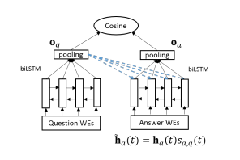

# Attentive LSTM for question answering

Implementation of the paper [Improved Representation Learning for Question Answer Matching](http://www.aclweb.org/anthology/P16-1044) on the WikiQA dataset. The model builds question and answer representations with bidirectional LSTMs, applies attention over the question, and trains with a cosine-similarity margin loss (TensorFlow 1.x via `tf.compat.v1`).

## Setup
- Requires Python 3.11+.
- Install dependencies (via Poetry or pip):
  - Poetry: `poetry install`
  - pip (without Poetry): `pip install tensorflow==2.17 nltk scikit-learn protobuf==3.20.3 keras numpy==1.26.4 PyYAML`

## Download GloVe embeddings
1. Download `glove.2024.wikigiga.100d.zip` from https://nlp.stanford.edu/projects/glove/.
2. Unzip it somewhere on disk and point `glove_file` in `config.yml` to the extracted `.txt` file (the default path is an example).
3. Set `embedding_size` to `100` in `config.yml` to match the 100d vectors.

## Train and evaluate
- The repo already includes `WikiQA-train.tsv` and `WikiQA-test.tsv`.
- Start training (uses settings in `config.yml`):
  - Poetry: `poetry run python train.py`
  - Directly: `python train.py`
- Add `y` to redirect stdout to `output.txt` if desired: `python train.py y`.
- Checkpoints are written to `model/`, and vocab/embeddings are dumped to `voc.txt` and `emb.txt`.

## Files
- `train.py` — training and evaluation loop driven by `config.yml`.
- `input_wikiqa.py` — dataset preprocessing for WikiQA.
- `model.py` — attention-based BiLSTM definition.
- `config.yml` — hyperparameters and file paths.
- `WikiQA-train.tsv`, `WikiQA-test.tsv` — dataset splits.

More background: [blog post](https://divishd.wordpress.com/2017/10/25/bi-directional-lstm-with-attention-for-question-answering-nlp/).
